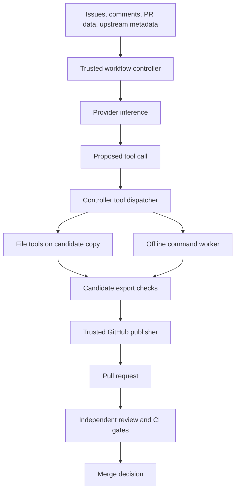
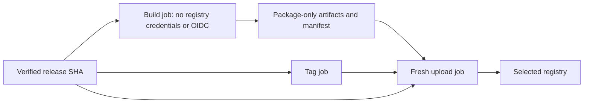

# Architecture and security boundaries

The supplemental [protected local mode](local-container.md) adds an audited
egress gateway, host supervisor and offline CI profiles without changing the
Actions boundaries described below.

[Documentation index](README.md)

[`THREAT_MODEL.md`](../THREAT_MODEL.md) defines the security contract. Use the
controller checks described here to enforce it; a model's reasoning cannot
supply missing enforcement.

## Data flow

Run reports use these terms:

- **Proposed:** the model selected a tool or described a change.
- **Prepared:** candidate files exist.
- **Validated:** the relevant controller checks passed.
- **Published:** GitHub confirmed a PR, issue, or comment.
- **Merged:** the merge step observed merged state.

## Execution zones

| Zone | Access | Restriction |
|---|---|---|
| Trusted controller | Checked-out automation, provider credentials, relevant GitHub permissions | Dispatches model-requested commands to the worker; does not run them on the host |
| Inference service/CLI | Supplied prompt, tool schema and provider authentication | Cannot use built-in repository tools or mutate GitHub |
| Candidate file tools | Temporary candidate workspace | Reject paths outside that workspace |
| Command worker | Candidate mount and image contents | Receives no credentials or network access |
| Publisher | Validated results and repository-scoped credentials | Requires review/validation evidence; cannot establish semantic safety by itself |

### Provider integration

The default adapter starts the pinned Copilot CLI in an empty home/working directory,
with built-in MCPs, custom instructions and built-in tools disabled. It validates
one JSON tool selection before dispatch. XML or invalid arguments trigger format
retries within the existing limits.
Actions prepares both Copilot backends with `npm ci` from committed tooling
locks. Runtime dependencies are integrity-locked as well as the top-level package.

Copilot accepts plain JSON or a complete JSON fence. The adapter allows at most
two format retries within the original 120-second deadline. Invalid output
executes no tool; authentication and process failures do not receive format
retries.

The opt-in SDK adapter reuses a pinned, SDK-managed stdio subprocess for the
provider attempt. Each selection uses a fresh empty-mode session with no tools,
configuration discovery, memory or compaction. A structured response selects a
controller tool; SDK callbacks never execute repository operations. Sessions
are not resumed or shared between repositories. Usage comes from a single
session metrics snapshot, with event accounting retained if retrieval fails.
Such retrieval failures fail the attempt rather than discarding observed usage.
The controller aborts timed-out work and shuts down the runtime before export.
The SDK client library runs in the trusted controller process and is part of
its trusted computing base. Empty mode restricts the child agent runtime; it
does not sandbox the client library. Its packages are pinned and installed
outside the candidate checkout.
See [SDK configuration](configuration.md#copilot-sdk-backend).

Anthropic, OpenAI, and OpenRouter use inference APIs through the controller.
The controller does not use the unrestricted Claude/Codex coding CLIs or
OpenRouter's former `claude-cli` path.

The shared tools are `read_file`, `write_file`, `edit_file`, `run_command` and
`finish_task`.

Provider usage comes from API metadata, SDK metrics or the private CLI usage file, not
model-supplied accounting.

### GitHub publication boundary

The shared `github-io.mjs` module binds mutations to GitHub.com and the installed
`owner/repo`. It overrides conflicting `GH_HOST`/`GH_REPO`
defaults, uses host-qualified repository arguments or `--hostname github.com`,
and rejects mismatched repository targets and positional external item URLs.
It rejects GitHub Enterprise installations. Installer label writes retain the
inspected origin's host.

Every checkout disables credential persistence. Branch and tag publication use
`github-io.mjs` with a command-scoped Git credential helper that reads the
publication step's `GH_TOKEN` or `GITHUB_TOKEN`. It verifies that the sole push
URL for `origin` is the installed HTTPS GitHub repository, rejects broad or
foreign pushes, and does not persist the token or helper configuration.
Manual callers of the Git publication helper need an explicit token too.

The publisher reconstructs issue, PR, review and release bodies with a restricted
Markdown grammar, including body-file inputs. Headings, lists, emphasis,
blockquotes and code render normally. Reference-bearing tokens (URLs, mentions,
issue references, entities and bare commit hashes) stay in code spans; raw HTML
and unsupported link syntax are not passed through as active markup. Code
delimiters exceed those in their content. Fences always use `text`, never
attacker-supplied language identifiers: Mermaid, math and other GitHub
enrichments are not allowed. Dollar-delimited math stays in inline code.
State markers remain literal blocks
so recovery can still read them. Oversized rendered content fails validation.

This is an allowlisted output encoder, not regex removal of suspicious links
from arbitrary Markdown. Tables and other unsupported constructs display as
text. Titles and generated commit messages use separate plain-text reference
neutralization because Markdown code delimiters do not protect those fields.

Confirmed PR links in run annotations and summaries remain clickable. The publisher appends an active
closing reference only for a controller-supplied local issue number. It fetches
and renders release notes before publishing, rather than using server-side
`--generate-notes`.

The merge code supplies sanitized messages and rejects automated rebase merges,
which would bypass that handling when rewriting commits. Use squash or a
reviewed manual merge.

### Candidate and command isolation

The candidate copy excludes `.git`, `node_modules`, `.venv`, and `__pycache__`.
File tools resolve paths and reject traversal. Command containers use:

- No network.
- No Linux capabilities and `no-new-privileges`.
- A non-root user and read-only container root.
- A temporary `/tmp`.
- CPU, memory, process-count, file-size, and command-time bounds.
- One writable host bind mount: the candidate directory.

The controller mounts none of the Docker socket, original checkout, provider
credentials, runner command files or user home. A failed worker command has no
host-shell fallback.

The export check rejects symlinks, special files, protected paths and changes
to the source made during execution. Bootstrap can change threat-model files.
Controller file tools reject symlinks in candidate path components,
including dangling links, before reading or creating files. Writes use exclusive
temporary files and atomic replacement, rather than following a candidate file
through `writeFileSync`; filesystem lookup errors fail closed.
Dependency stages D through F add manifest, resolution and independent-test
requirements before export.

These controls rely on the host kernel, Docker daemon, worker image, controller
code and trusted default-branch automation. Review and pin images before use.
An untrusted shared self-hosted runner needs stronger host isolation than these
containers provide.

### Check source files for secrets

A local `.env`, checked-in token or private source file can enter the candidate
and prompt. Use a clean checkout without secrets. The copy step excludes
environment credentials but does not redact source files, and filesystem
isolation cannot recall data sent to a provider.

## Workflow audit decisions

The supplied zizmor 1.31.1 offline report contained 20 visible findings. The
following decisions cover every occurrence; they do not claim that offline
linting proves the workflows free of vulnerabilities.

| Audit | Occurrences | Disposition |
|---|---|---|
| `github-env` | 1 | Runner-owned path, not attacker input. Removed the environment-file write anyway; the agent step now declares its tooling directories directly. |
| `adhoc-packages` | 2 | Fixed with committed CLI manifests/locks and `npm ci --ignore-scripts`, including transitive dependencies. |
| `artipacked` | 5 | No demonstrated artifact leak, but persistence was unnecessary outside publication. All checkouts now disable it; Git pushes obtain step-scoped credentials without storing them. |
| `self-repository` | 7 | Replaced workspace-relative action references with commit-bound `$/` references. |
| `cache-poisoning` | 1 | Implicit npm caching was inactive here, but could activate in an adopting repository. Every `setup-node` step now sets `package-manager-cache: false`. |
| `dangerous-triggers` | 3 | Retained with narrow annotations: trusted base code, association-based event admission, data-only external inputs, isolated workers and fresh merge checks. No triggering-run artifact or PR-head code is executed on the controller. |
| `use-trusted-publishing` | 1 | Supported compatibility exception, not a false positive when a token is configured. Empty `PYPI_API_TOKEN` selects OIDC; supplying a token deliberately selects the legacy path. |

The trigger annotations depend on the current controls. Reassess them before
changing checkout refs, loading triggering-run artifacts, admitting other
actors or allowing host-side model commands. The admission policy trusts
GitHub's OWNER, MEMBER and COLLABORATOR associations; it is not a repository-role
lookup. Adopters must accept that trust policy.

`$/` pins the action definition to the workflow commit, but the controller
scripts still come from the trusted checkout. These workflows therefore keep
their checkout steps. The syntax requires GitHub.com runner 2.336.0 or newer.

Operational state caches remain separate from dependency caches; they are
needed for run/budget accounting and are not restored by the release uploader.
Their existing cache-scope and durability limitations still apply.
The cache-access action gates restores and saves using the runner's effective
mode (or conservative trigger defaults on older runners). It does not grant
cache-write access to low-trust events. Scheduled agents share one restored
ledger; read-only runs cannot persist new usage through the cache.

For PyPI, configure a Trusted Publisher and remove the token secret to use
OIDC. If a legacy token remains necessary, limit it to the package being
published and rotate it. The inline exception does not remove that residual
credential risk.

## Workflow token permissions

Every workflow starts with `permissions: {}`. Each job declares its own grants;
unlisted permissions are disabled. The grants cover these operations:

| Job | `GITHUB_TOKEN` permissions |
|---|---|
| Self-tests; release planning and package builds; website build | Contents read |
| Issue handling; scheduled maintenance | Contents, Issues and Pull requests write |
| PR review and merge gate | Contents and Pull requests write; Checks and Commit statuses read |
| CI requirement discovery | Contents, Checks, Commit statuses and Actions read |
| Release tag and GitHub Release publication | Contents write |
| OIDC/provenance package uploads | Contents read; ID token write |
| Token-only package uploads | Contents read |
| GitHub Pages deployment | Pages and ID token write |

The PR gate needs Contents write to merge and Pull requests write for reviews
and labels. It reads both check runs and legacy statuses, but does not call
Actions APIs. CI discovery does call those APIs to map checks to workflow names.
Scheduled maintenance does not upload SARIF or write code-scanning results, so
it has no Security events grant.

Release uploads are split by authentication needs. npm needs OIDC for tokenless
publishing or requested provenance; PyPI needs it only without an API token.
Token-only uploads cannot mint OIDC tokens. See [registry support](releases.md#registry-support).

Website deployment runs only on manual dispatch from the default branch.
Its separate deployment job publishes the website artifact to GitHub Pages
without repository-write or package-registry credentials.

Issue, scheduled-maintenance and PR-gate jobs still combine analysis with
publication or merging. Their permissions are the union needed by the job,
not a separate boundary around each step. Agent calls no longer explicitly
receive the repository token in their environment, but trusted actions can
still access the job's token context. Isolating those phases would require
separate jobs and a validated handoff.

These declarations constrain `GITHUB_TOKEN`, not supplied PATs, Copilot tokens
or registry secrets. Scope each of those separately. The optional setup PAT
also needs Administration read to inspect classic branch protection.

Self-tests and read-only CI discovery cancel superseded runs. Maintenance
retains its shared, non-cancelling concurrency group for budget accounting.

## Deterministic PR gates

The PR workflow checks out trusted base code and fetches the PR as data. It does
not execute a contributor's head checkout with the privileged token.

The default merge path requires:

1. Valid metadata and a complete file inventory matching GitHub's
   `changed_files`, including rename origins. PRs beyond the 3,000-file endpoint
   cap need manual review.
2. No blocking pause/ignore/hold condition, and the PR is not a draft. Automation never marks a draft ready.
3. No unapproved protected-file changes or reported breaking API change.
4. No match for selected dangerous diff patterns.
5. An allowed author category or explicit author-policy opt-in.
6. A fresh, completed, non-dry-run independent `APPROVE` result and all four required gates set to `PASS`.
7. Successful current checks/statuses for the exact head SHA, including an
   configured trusted required set.

The controller pins the GitHub merge request to the reviewed head SHA. Configure
server-side required checks as an additional defense against changes between
the final query and the merge.

For formal review submission, the controller rechecks the
open PR head, then posts through the REST review endpoint with an explicit
`commit_id`. A concurrent push cannot attach that review to the newer commit.
The controller rejects stale/closed PRs and does not retry permission errors
as unbound approvals. It submits a commit-bound `COMMENT` for self-authored
Actions PRs, which GitHub does not let the author approve.

### Check identity is not workflow identity

`app_id: 15368` distinguishes a GitHub Actions check from a check submitted by
another app. It does not identify which workflow file produced the check.
Review changes to CI definitions and keep branch protection appropriate for
the repository.

### Remaining risks

- A passing test suite may miss a regression or backdoor.
- A malicious package may have no known advisory.
- Downstream metadata cannot establish consumer compatibility.
- Some prompt policies still depend on model judgment.
- Risk labels and compatibility claims need supporting evidence.
- Regex command checks and link formatting cannot replace process/network
  isolation.

## State and authorization

Labels such as `lights-on:automerge` and `lights-on:approved-override` are
maintainer controls. The controller filters agent-requested label changes and
rejects delimiters that could turn one label into several.

Comment state markers are bookkeeping only. Publishers remove pre-existing
markers from their output and append controlled metadata; recovery checks
recognized authors. The PR workflow does not reuse comment markers as approval.

Migration execution uses a reviewed default-branch configuration plan. Planning
issues and `lights-on:migrate-dep` do not grant execution permission.

## Release isolation

Upload jobs use trusted controller scripts from the original release SHA.
They validate artifact paths,
identity fields, and hashes before upload. A Python 3.11+ inspector uses standard
libraries, plus Ruby/Psych syntax trees for RubyGems, to read archive metadata
without extracting files or executing package code, and binds each package's
internal name/version to trusted source
manifests or configured package names. The inspector rejects duplicate/unsafe
members, excessive expansion, unexpected packages and missing expected targets.
The uploader runs registry commands outside the project tree and does not
execute build code with upload credentials.

Hashes detect corruption after packaging. A malicious build can produce a
correctly hashed package; see [release operation](releases.md).

## Paid-work admission and remaining resource risks

External events require maintainer authorization by default. Agent-bearing
workflows serialize against a shared repository concurrency group, and a
file-locked state update reserves attempts and budget before inference. Failed
or interrupted attempts remain in the current ledger.
Provider-request byte limits and a shared model-call ceiling limit retry abuse.

GitHub Actions can replace pending work with newer events. Read-only cache
tokens on issue/PR-related triggers prevent those runs from persisting new
usage through the cache. Cache eviction,
service failures, killed hosts and custom workflows can lose reservations or
work. Enabling external triggers adds spending exposure. Investigate stale
`.lock` files before clearing them; they block new reservations.
Keep provider-side spending limits and repository-scoped credentials in place.

## Implementation map

| Module | Responsibility |
|---|---|
| [`run-agent.mjs`](../.github/lights-on/runner/run-agent.mjs) | Routing, task budgets, candidate lifecycle, normalized results |
| [`provider-completion.mjs`](../.github/lights-on/runner/provider-completion.mjs) | Inference adapters and Copilot format/usage handling |
| [`openrouter-agent.mjs`](../.github/lights-on/runner/openrouter-agent.mjs) | Shared tool loop and checked file tools |
| [`agent-sandbox.mjs`](../.github/lights-on/runner/agent-sandbox.mjs) | Worker creation, inventory, candidate export |
| [`dependency-work.mjs`](../.github/lights-on/runner/dependency-work.mjs) | Bounded dependency selection and validation |
| [`verify-pr-safety.mjs`](../.github/lights-on/runner/verify-pr-safety.mjs) | PR metadata, path, review, and merge-policy checks |
| [`verify-ci.mjs`](../.github/lights-on/runner/verify-ci.mjs) | Complete check/status collection and required identities |
| [`publish-pr.mjs`](../.github/lights-on/runner/publish-pr.mjs) | Confirmed PR creation/reuse, required labels, and safe Markdown body preparation |
| [`github-io.mjs`](../.github/lights-on/runner/github-io.mjs) | Host/repository-bound GitHub calls and final body-file sanitization |
| [`publication-text.mjs`](../.github/lights-on/runner/publication-text.mjs) | Restricted Markdown rendering, literal excerpts and plain-text reference neutralization |
| [`usage.mjs`](../.github/lights-on/runner/usage.mjs) | Usage normalization and incomplete-cost handling |
| [`run-budget.mjs`](../.github/lights-on/runner/run-budget.mjs) | File-locked pre-inference reservations and settlement |
| [`event-policy.mjs`](../.github/lights-on/runner/event-policy.mjs) | Admission of paid event-triggered work |
| [`package-identity.py`](../.github/lights-on/runner/package-identity.py) | Non-executing distribution metadata inspection |
| [`workflow-report.mjs`](../.github/lights-on/runner/workflow-report.mjs) | Escaped annotations and linked job summaries |
